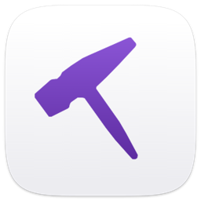
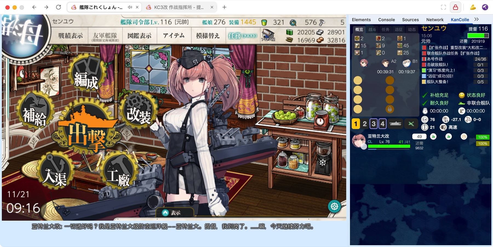

#  damecon-browser

[English](README.md) · [简体中文](README.zh-CN.md) · [繁體中文](README.zh-TW.md) · 日本語

『艦隊これくしょん -艦これ-』をプレイするためのタブ型ブラウザです。KC3Kai と KCCacheProxy を内蔵し、HTTP / SOCKS5 プロキシに対応しています。



本プロジェクトは [planetarian/damecon-browser](https://github.com/planetarian/damecon-browser) のフォークで、macOS を主な対象とし、[electron-browser-shell](https://github.com/samuelmaddock/electron-browser-shell) と Electron 44 をもとに構築しています。各リリースでは Apple Silicon および Intel Mac 向けのビルドと、Windows 向けの zip（x64、arm64）を配布しています。なお、Windows 版の動作テストは限定的です。

> Damecon は『艦これ』のプレイ専用に作られており、汎用ブラウザではありません。一般的なブラウザが備える多くのセキュリティ機能を備えていないため、機密性の高い情報の取り扱いには使用しないでください。

## インストールと使い方

[Releases ページ](https://github.com/yecl/damecon-browser/releases/latest)から最新版をダウンロードしてください（KC3Kai はアプリ内で自動更新され、Damecon 本体の新しいバージョンも同ページで公開されます）：

- **macOS（13 Ventura 以降）**：
  1. お使いの Mac に合わせた `.dmg`（Apple Silicon は `arm64`、Intel Mac は `x64`）を開きます。
  2. Damecon を「アプリケーション」フォルダにドラッグ＆ドロップします。
  3. アドホック署名のみで公証は受けていないため、初回起動がブロックされた場合は、**システム設定 → プライバシーとセキュリティ**を開いて**このまま開く**をクリックしてください。
- **Windows**：
  1. `.zip` ファイルを専用のフォルダに展開します。
  2. 展開したフォルダ内の `damecon-browser.exe` を実行します。

初回起動時、Damecon は自動的に KC3Kai をダウンロードしてスタートページを開きます。タブバー右端の Damecon アイコンから**設定**を開けます。

### ポータブル版として使う

**設定 → Damecon → データ**でデータの保存場所を**アプリと同じ場所**に設定すると、すべてのデータがアプリと同じ階層の `damecon-data` フォルダに保存され、macOS 版と Windows 版で共有できます：

```
Damecon/
  damecon-browser.app/
  damecon-browser-win32-x64-<version>/
  damecon-data/
```

設定、KC3Kai のデータ、KCCP のキャッシュや mod はすべてこのフォルダごと持ち運べます。ただし DMM のログイン情報は端末ごとに暗号化されるため、OS や PC を切り替えた際は再ログインが必要です。macOS で同階層のフォルダが読み込めない場合は、ターミナルで以下のコマンドを実行して隔離属性を解除してください：

```bash
xattr -dr com.apple.quarantine damecon-browser.app
```

### ソースコードからビルドする

Node.js 22.12 以降が必要です：

```bash
git clone https://github.com/yecl/damecon-browser
cd damecon-browser
yarn
yarn start
```

## KC3Kai

**設定 → KC3Kai** で更新チャンネルを選択できます：

- `release`（推奨・安定版）、`master`、または `develop`（開発版）。
- `custom`（カスタム 1 / カスタム 2）：ご自身で管理しているローカルの KC3 フォルダを指定します。

チャンネルごとに本体とデータが独立しているため、切り替えても再ダウンロードは発生しません。不要になったチャンネルを削除する場合は、`extensions` フォルダ内の該当する `kc3kai-*` フォルダを削除してください。

## プロキシと KCCacheProxy

**プロキシ**ページ上部のルート図で、通信の種類ごとの経路を確認できます：

- **プロキシ**：有効にすると、Web サイト閲覧、ログイン、KC3 の更新、Chrome ウェブストア、内蔵 KCCP のダウンロードを含むすべての通信が指定した HTTP / SOCKS5 プロキシを経由します。なお、ZeroOmega など `chrome.proxy` API を使用する拡張機能には対応していません。
- **[KCCacheProxy](https://github.com/Tibowl/KCCacheProxy)（KCCP）**：ゲーム素材をローカルディスクにキャッシュして読み込みを高速化し、素材 mod を適用します。KCCP が処理するのはゲームサーバー（`*.kancolle-server.com`）宛ての通信のみで、プロキシの手前で動作します。Damecon はこれらのサーバーに限って KCCP の証明書を信頼するため、システムのキーチェーンには何も登録されません。
  - **内蔵**：Damecon 自身が KCCP を実行します。キャッシュ、mod、設定ファイルは `userdata/kccp` に保存されます。
  - **外部**：ご自身で起動している KCCP を指定します（HTTPS / MITM ポートを入力）。ゲームサーバーへは KCCP 自身のネットワーク経由で接続します。

**KCCP** ページでは稼働状況、統計、リアルタイムのログを確認でき、**素材を事前読み込み**、**キャッシュダンプをインポート**、**キャッシュを検証**といったキャッシュ管理ツールを利用できます。通常、KCCP はゲーム内で読み込んだ素材のみをキャッシュしますが、**ゲーム素材を常に KCCP へ要求する**を有効にするか**ブラウザキャッシュを消去**を実行することで、キャッシュを蓄積できます。

### 素材 mod

内蔵 KCCP を使用している場合、KCCP ページの **Mod** タブで次の 3 通りの方法を管理できます：

- **KCCP mod**：git リポジトリからのインストール、`.mod.json` の追加、poi mod の変換に対応しています。画像の該当部分のみを置き換えるため、ゲームのアップデート後も引き続き動作します。
- **`.hack` ファイル**：**.hack ファイルを使用する**を有効にしたうえで、ゲーム内のパス構成に沿って `<name>.hack.<ext>` を hack フォルダに配置します（例：`kcs2/resources/ship/full/<file>.hack.png`）。こちらはファイル全体を置き換えます。
- **艦娘の `config.ini`（島風GO 形式）**：hack フォルダ内の `kcs/resources/swf/ships/<ship file>.config.ini` を配置すると、ゲーム起動時に艦娘の表示位置や艦名を調整できます。

`.hack` や `config.ini` ファイルを追加・削除した後は、**再読み込み**をクリックして反映してください。

## 拡張機能

`extensions` フォルダに配置した展開済みの拡張機能は自動的に読み込まれます（Manifest V2 / V3 両対応）。Chrome ウェブストアからのインストールも可能です。ただし一部の拡張機能 API が未実装のため、すべての拡張機能が動作するわけではありません（`chrome.proxy`、`webRequest.onAuthRequired`、および DevTools や iframe 内の拡張機能ページから使用する `tabs` / `windows` / `downloads` API など）。

## ゲームとブラウザ操作

- **ウィンドウに合わせる**：タブバーのこのボタンをクリックすると、DMM ページ・KC3 ゲームページのいずれでもゲーム画面がタブ全体に合わせて拡大表示されます。また、**設定 → Damecon → 艦これ → フレームレート**から最大 240 FPS での動作に対応します。
- **アドレスバー**：選択中のタブをクリックするか、`Cmd/Ctrl+L` を押すと URL を入力できます。
- **ショートカット**：`Cmd+[` / `Cmd+]`（Windows では `Alt+←` / `Alt+→`）またはマウスのサイドボタンで戻る・進む、`Cmd/Ctrl+Shift+T` で閉じたタブを開き直す、`Cmd/Ctrl+F` でページ内を検索できます。
- **サイト権限**：Web サイトがカメラ、位置情報、通知などの権限を使用する前に、確認ダイアログで許可を求めます。
- **表示言語**：英語、簡体字中国語、繁体字中国語、日本語に対応しています。初期設定は**システム設定に従う**になっており、**設定 → Damecon → ウィンドウ → 言語**からいつでも変更できます。

## ライセンス

GPL-3

本プロジェクトは Samuel Maddock 氏の [electron-browser-shell](https://github.com/samuelmaddock/electron-browser-shell) をもとにしています。

以下は元のリポジトリから引き継いだ告知です（英語の原文が優先されます）：

> For proprietary use [of electron-browser-shell], please [contact [samuelmaddock]](mailto:sam@samuelmaddock.com?subject=electron-browser-shell%20license) or [sponsor [samuelmaddock] on GitHub](https://github.com/sponsors/samuelmaddock/) under the appropriate tier to [acquire a proprietary-use license](https://github.com/samuelmaddock/electron-browser-shell/blob/master/LICENSE-PATRON.md). These contributions help make development and maintenance of this project more sustainable and show appreciation for the work thus far.

### コントリビューターライセンス契約

コントリビューターライセンス契約については[英語版](README.md#contributor-license-agreement)が適用されます。
