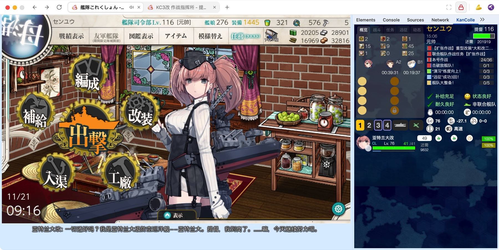

#  damecon-browser

English · [简体中文](README.zh-CN.md) · [繁體中文](README.zh-TW.md) · [日本語](README.ja.md)

A tabbed browser built for playing Kantai Collection, with KC3Kai and KCCacheProxy built in plus HTTP/SOCKS5 proxy support.



A macOS-focused fork of [planetarian/damecon-browser](https://github.com/planetarian/damecon-browser), built on [electron-browser-shell](https://github.com/samuelmaddock/electron-browser-shell) and Electron 44. Releases ship builds for Apple Silicon and Intel Macs as well as Windows zips (`x64`, `arm64`); the Windows builds receive less testing.

> Damecon is designed for playing KanColle, not for general browsing. It lacks many of the security features of mainstream browsers — do not use it for sensitive accounts or data.

## Install

Download the latest release from the [Releases page](https://github.com/yecl/damecon-browser/releases/latest) (KC3Kai updates itself inside the app, and new Damecon versions are published there):

- **macOS** (13 Ventura or later):
  1. Download and open the `.dmg` for your Mac (`arm64` for Apple Silicon, `x64` for Intel).
  2. Drag Damecon into **Applications**.
  3. The app is signed ad-hoc and not notarized: after macOS blocks the first launch, open **System Settings → Privacy & Security** and click **Open Anyway**.
- **Windows**:
  1. Extract the `.zip` archive into its own folder.
  2. Run `damecon-browser.exe`.

On first launch, Damecon downloads KC3Kai and opens its start page. Click the Damecon icon at the right end of the tab bar to open **Settings**.

### Portable use

In **Settings → Damecon → Data**, selecting **Next to the app** stores all data in a `damecon-data` folder beside the app, shared between the macOS and Windows builds:

```
Damecon/
  damecon-browser.app/
  damecon-browser-win32-x64-<version>/
  damecon-data/
```

Settings, KC3Kai data, the KCCP cache and mods all travel with the folder. Because DMM logins are encrypted per computer, you will need to sign in again when switching machines or builds. On macOS, if the app cannot see the folder next to it, clear the quarantine attribute first:

```bash
xattr -dr com.apple.quarantine damecon-browser.app
```

### From source

Requires Node.js 22.12 or later:

```bash
git clone https://github.com/yecl/damecon-browser
cd damecon-browser
yarn
yarn start
```

## KC3Kai

Under **Settings → KC3Kai**, pick an update channel:

- **Release** (recommended, stable), **Master** or **Develop**.
- **Custom 1** / **Custom 2**: point to a local KC3 folder you manage yourself.

Each channel keeps its own copy and data, so switching channels does not re-download. To remove a channel, delete its `kc3kai-*` folder inside `extensions`.

## Proxy and KCCacheProxy

The route map at the top of **Settings → Proxy** shows how each kind of traffic is routed:

- **Proxy**: when **Use a proxy** is enabled, all traffic — websites, logins, KC3 updates, the Chrome Web Store and the built-in KCCP's downloads — goes through your HTTP or SOCKS5 proxy. Extensions based on `chrome.proxy` (such as ZeroOmega) are not supported.
- **[KCCacheProxy](https://github.com/Tibowl/KCCacheProxy) (KCCP)**: caches game assets on disk for faster loading and applies asset mods. Only game servers (`*.kancolle-server.com`) go through KCCP, in front of the proxy. Damecon trusts KCCP's certificate for those servers only and never touches the system keychain.
  - **Built-in**: Damecon runs KCCP itself; its cache, mods and `config.json` live in `userdata/kccp`.
  - **External**: connect to a KCCP instance you run yourself (enter its HTTPS/MITM port). It reaches the game servers on its own network rather than through Damecon's proxy.

The **KCCP** page shows running status, stats and a live log, plus cache tools (**Preload assets**, **Import cache dump**, **Verify cache**). By default KCCP caches only assets loaded during play; turn on **Always ask KCCP for game assets** or run **Clear browser cache** (**Settings → Damecon → Data → Maintenance**) to fill it.

### Asset mods

With the built-in KCCP, open the **Mods** tab on the KCCP page:

- **KCCP mods**: install from git, add a `.mod.json`, or convert a poi mod. Because they patch only the changed parts of an image, they usually survive game updates.
- **`.hack` files**: turn on **Use .hack files** and place `<name>.hack.<ext>` under the game path in the hack folder (e.g. `kcs2/resources/ship/full/<file>.hack.png`) to replace whole files.
- **Ship `config.ini`** (岛风GO format): place `<ship file>.config.ini` in `kcs/resources/swf/ships/` inside the hack folder to adjust ship positions and names when the game starts.

Click **Reload** after adding or removing `.hack` or `config.ini` files.

## Extensions

Unpacked extensions placed in `extensions` load automatically (Manifest V2 and V3), and extensions can also be installed from the Chrome Web Store. Enable, disable or remove installed extensions under **Settings → Extensions**. Some extension APIs are not implemented — including `chrome.proxy`, `webRequest.onAuthRequired`, and the `tabs`, `windows` and `downloads` APIs inside DevTools or iframe extension pages — so not every extension will work.

## Game and browser

- **Fit game to window**: click the button with four corner marks just right of the tabs to zoom the game to fill the tab (works on both the DMM page and KC3's game pages); set **Frame rate** under **Settings → Damecon → KanColle** to run at up to 240 FPS.
- **Address field**: click the selected tab, or press `Cmd/Ctrl+L` or `Alt+D`, to enter a URL.
- **Shortcuts**: go back and forward with `Cmd+[` / `Cmd+]` (`Alt+←` / `Alt+→` on Windows and Linux) or mouse side buttons; `Cmd/Ctrl+Shift+T` reopens closed tabs; `Cmd/Ctrl+1–9` switches tabs; `Cmd/Ctrl+F` finds in page.
- **Site permissions**: sites ask (**Block** / **Allow**) before using the camera, location, notifications and similar permissions.
- **Language**: available in English, Simplified Chinese, Traditional Chinese and Japanese — **System** by default, or set under **Settings → Damecon → Window → Language**.

## License

GPL-3

This project is based on the [electron-browser-shell](https://github.com/samuelmaddock/electron-browser-shell) project by Samuel Maddock.

The following notice has been retained from the original repository:

> For proprietary use [of electron-browser-shell], please [contact [samuelmaddock]](mailto:sam@samuelmaddock.com?subject=electron-browser-shell%20license) or [sponsor [samuelmaddock] on GitHub](https://github.com/sponsors/samuelmaddock/) under the appropriate tier to [acquire a proprietary-use license](https://github.com/samuelmaddock/electron-browser-shell/blob/master/LICENSE-PATRON.md). These contributions help make development and maintenance of this project more sustainable and show appreciation for the work thus far.

### Contributor license agreement

By sending a pull request, you hereby grant to owners and users of the
electron-browser-shell project a perpetual, worldwide, non-exclusive,
no-charge, royalty-free, irrevocable copyright license to reproduce, prepare
derivative works of, publicly display, publicly perform, sublicense, and
distribute your contributions and such derivative works.

The owners of the damecon-browser/electron-browser-shell projects will also be granted the right to relicense the
contributed source code and its derivative works.
