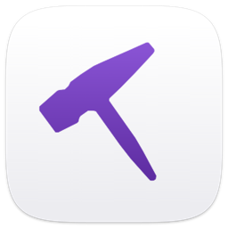

#  damecon-browser

English · [简体中文](README.zh-CN.md) · [繁體中文](README.zh-TW.md) · [日本語](README.ja.md)

A tabbed browser for playing Kantai Collection, with KC3Kai built in, a built-in KCCacheProxy and HTTP/SOCKS5 proxy support.


A macOS-focused fork of [planetarian/damecon-browser](https://github.com/planetarian/damecon-browser), built on [electron-browser-shell](https://github.com/samuelmaddock/electron-browser-shell) and Electron 44. Releases ship builds for Apple Silicon and Intel Macs and Windows zips (x64, arm64); the Windows builds get less testing.

> Damecon is made for playing KanColle, not for general browsing. It lacks many of the security features of major browsers; use it for anything sensitive at your own risk.

## Install

Download the latest build from the [Releases page](https://github.com/yecl/damecon-browser/releases/latest). KC3Kai updates itself; new Damecon versions appear there.

- **macOS** (13 Ventura or later): open the `arm64` (Apple Silicon) or `x64` (Intel) `.dmg` and drag Damecon to Applications. The app is signed ad-hoc but not notarized: open it once, then click **Open Anyway** in System Settings → Privacy & Security.
- **Windows**: extract the zip into its own folder and run `damecon-browser.exe`.

On first launch Damecon downloads KC3Kai and opens its start page. The Damecon button at the right of the tab bar opens the settings.

### Portable use

Settings → Damecon → Data → **Next to the app** keeps everything in a `damecon-data` folder beside the app, shared by the macOS and Windows builds:

```
Damecon/
  damecon-browser.app/
  damecon-browser-win32-x64-<version>/
  damecon-data/
```

Settings, KC3Kai data, the KCCP cache and mods travel with the folder; switching to the other build requires signing in to DMM again. On macOS, the quarantine flag may need to be cleared first with: `xattr -dr com.apple.quarantine damecon-browser.app`.

### From source

Requires Node.js 22.12 or later.

```bash
git clone https://github.com/yecl/damecon-browser
cd damecon-browser
yarn
yarn start
```

## KC3Kai

The KC3Kai settings page picks the update channel: `release` (recommended), `master` or `develop`, or `custom` for a KC3 folder you manage yourself. Each channel keeps its own copy and data, so switching doesn't re-download; delete its `kc3kai-*` folder under `extensions` to remove one.

## Proxy and KCCacheProxy

The **Proxy** page shows the route each kind of traffic takes.

- **Proxy**: an HTTP or SOCKS5 proxy carries everything: websites, logins, KC3 updates, the web store and the built-in KCCP's downloads. `chrome.proxy` extensions such as ZeroOmega aren't supported.
- **[KCCacheProxy](https://github.com/Tibowl/KCCacheProxy)** keeps game assets on disk and applies asset mods. It can take the game servers (`*.kancolle-server.com`) only, in front of the proxy. Damecon trusts its certificate for those servers only, so nothing goes into the system keychain.
  - **Built-in**: Damecon runs KCCP itself; its cache, mods and config live in `userdata/kccp`.
  - **External**: a KCCP you run yourself (its HTTPS/MITM port). It reaches the game servers on its own network.

The **KCCP** page shows status, stats and a live log, and has cache tools (preload, import a dump, verify). KCCP only caches what passes through it; turn on **Always ask KCCP for game assets** or clear the browser cache to fill it.

### Asset mods

With the built-in KCCP, on the KCCP page's **Mods** tab:

- **KCCP mods**: install from git, add a `.mod.json`, or convert a poi mod. They replace only the matching parts of an image, so they survive game updates.
- **`.hack` files**: with **Use .hack files** on, put `<name>.hack.<ext>` under the game path in the hack folder, e.g. `kcs2/resources/ship/full/<file>.hack.png`. They replace the whole file.
- **Ship `config.ini`** (岛风GO format): `kcs/resources/swf/ships/<ship file>.config.ini` in the hack folder sets ship positions and names when the game starts.

Press **Reload** after adding or removing `.hack` or `config.ini` files.

## Extensions

Unpacked extensions in `extensions` load automatically, Manifest V2 and V3, and Chrome Web Store installs work. Some extension APIs are missing, so not every extension runs; among them `chrome.proxy`, `webRequest.onAuthRequired`, and the `tabs`/`windows`/`downloads` APIs for extension pages inside DevTools or iframes.

## Game and browser

- **Fit** (tab bar) zooms the game to fill the tab, on the DMM page and KC3's game pages alike; a frame rate setting runs the game at up to 240 FPS.
- Click the selected tab, or press Cmd/Ctrl+L, to type an address.
- Back/forward with Cmd+[ / Cmd+] (Alt+← / Alt+→ on Windows) or the mouse side buttons; Cmd/Ctrl+Shift+T reopens a closed tab; Cmd/Ctrl+F finds in page.
- Sites ask before using the camera, location, notifications and similar permissions.
- The interface is in English, Simplified Chinese, Traditional Chinese or Japanese, following the system unless set in Settings → Damecon → Window → Language.

## License

GPL-3

This project is based on the [electron-browser-shell](https://github.com/samuelmaddock/electron-browser-shell) project by Samuel Maddock.

The following notice has been retained from the original repository:

> For proprietary use [of electron-browser-shell], please [contact [samuelmaddock]](mailto:sam@samuelmaddock.com?subject=electron-browser-shell%20license) or [sponsor [samuelmaddock] on GitHub](https://github.com/sponsors/samuelmaddock/) under the appropriate tier to [acquire a proprietary-use license](https://github.com/samuelmaddock/electron-browser-shell/blob/master/LICENSE-PATRON.md). These contributions help make development and maintenance of this project more sustainable and show appreciation for the work thus far.

### Contributor license agreement

By sending a pull request, you hereby grant to owners and users of the
electron-browser-shell project a perpetual, worldwide, non-exclusive,
no-charge, royalty-free, irrevocable copyright license to reproduce, prepare
derivative works of, publicly display, publicly perform, sublicense, and
distribute your contributions and such derivative works.

The owners of the damecon-browser/electron-browser-shell projects will also be granted the right to relicense the
contributed source code and its derivative works.
