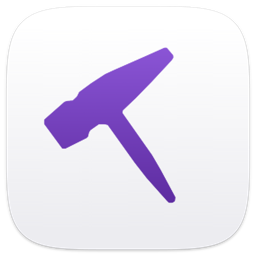
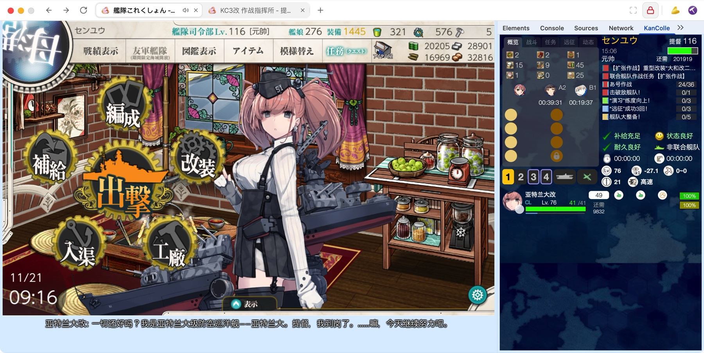

#  damecon-browser

[English](README.md) · 简体中文 · [繁體中文](README.zh-TW.md) · [日本語](README.ja.md)

一款专为《舰队 Collection》打造的多标签页浏览器，内置 KC3Kai 与 KCCacheProxy，并支持 HTTP / SOCKS5 代理。



本项目衍生自 [planetarian/damecon-browser](https://github.com/planetarian/damecon-browser)，以 macOS 为主要适配平台，基于 [electron-browser-shell](https://github.com/samuelmaddock/electron-browser-shell) 与 Electron 44 构建。每个版本均提供 Apple Silicon 与 Intel Mac 安装包，以及 Windows 压缩包（x64、arm64）；其中 Windows 版本的测试相对有限。

> Damecon 专为游玩《舰队 Collection》而设计，并非通用浏览器，缺少主流浏览器的多项安全防护机制。请勿在其中处理敏感信息，否则相关风险需自行承担。

## 安装与使用

请前往 [Releases 页面](https://github.com/yecl/damecon-browser/releases/latest)下载最新版本（KC3Kai 会在应用内自动更新，Damecon 本身的更新也会发布于此）：

- **macOS（13 Ventura 及以上版本）**：
  1. 下载并打开对应架构的 `.dmg` 安装包（Apple Silicon 请选 `arm64`，Intel Mac 请选 `x64`）。
  2. 将 Damecon 拖入“应用程序”文件夹。
  3. 由于应用采用临时签名（ad-hoc）且未经 Apple 公证，首次打开被拦截后，请前往**系统设置 → 隐私与安全性**，点击**仍要打开**。
- **Windows**：
  1. 将 `.zip` 压缩包完整解压到一个独立的文件夹中。
  2. 运行其中的 `damecon-browser.exe`。

首次启动时，Damecon 会自动下载 KC3Kai 并打开其开始页。点击标签栏右侧的 Damecon 图标即可进入**设置**。

### 便携模式

在**设置 → Damecon → 数据**中将数据存储位置设为**应用旁**后，所有数据都会保存在程序同级的 `damecon-data` 文件夹内，可供 macOS 版与 Windows 版共用：

```
Damecon/
  damecon-browser.app/
  damecon-browser-win32-x64-<version>/
  damecon-data/
```

所有设置、KC3Kai 数据、KCCP 缓存和 mod 都会随该文件夹一并迁移；不过 DMM 登录凭据按设备加密保存，跨平台切换时需要重新登录 DMM 账号。在 macOS 上，如果应用无法读取同级文件夹，请先在终端执行以下命令清除隔离属性：

```bash
xattr -dr com.apple.quarantine damecon-browser.app
```

### 从源码构建

构建前请确保已安装 Node.js 22.12 或更高版本：

```bash
git clone https://github.com/yecl/damecon-browser
cd damecon-browser
yarn
yarn start
```

## KC3Kai

可在**设置 → KC3Kai** 中选择更新渠道：

- `release`（推荐，稳定版）、`master` 或 `develop`（开发版）。
- `custom`（自定义 1 / 自定义 2）：指向你自行管理的本地 KC3 文件夹。

各渠道的程序文件与数据彼此独立，切换渠道不会重新下载。若不再需要某个渠道，直接删除 `extensions` 文件夹下对应的 `kc3kai-*` 文件夹即可。

## 代理与 KCCacheProxy

**代理**页上方展示了各类网络流量的路由方式：

- **代理**：开启后，所有网络流量（网页访问、账号登录、KC3 更新、Chrome 网上应用店以及内置 KCCP 的资源下载）都会通过指定的 HTTP 或 SOCKS5 代理转发。不支持 ZeroOmega 等依赖 `chrome.proxy` API 的扩展程序。
- **[KCCacheProxy](https://github.com/Tibowl/KCCacheProxy)（KCCP）**：将游戏资源缓存在本地磁盘中以加速加载，并支持应用资源 mod。KCCP 仅接管游戏服务器（`*.kancolle-server.com`）的流量，且位于代理之前；Damecon 仅针对这些域名信任 KCCP 证书，不会向系统钥匙串写入任何根证书。
  - **内置**：由 Damecon 直接托管运行，缓存、mod 与配置文件均保存在 `userdata/kccp` 中。
  - **外部**：连接你自己运行的 KCCP 实例（填写其 HTTPS / MITM 端口），由外部 KCCP 通过自身网络直连或代理访问游戏服务器。

在 **KCCP** 页中可查看运行状态、流量统计与实时日志，并使用**预加载资源**、**导入缓存包**、**校验缓存**等工具。默认情况下，KCCP 只会缓存实际请求过的资源；开启**始终向 KCCP 请求游戏资源**或执行一次**清除浏览器缓存**，即可逐步填充本地缓存。

### 资源 mod

启用内置 KCCP 后，可在 KCCP 页的 **Mod** 标签页中管理以下三种方式：

- **KCCP mod**：支持从 git 仓库安装、添加 `.mod.json` 文件或转换 poi mod。由于只替换素材中的对应局部，游戏版本更新后通常仍可继续使用。
- **`.hack` 文件**：开启**使用 .hack 文件**后，按游戏资源路径将 `<name>.hack.<ext>` 放入 hack 文件夹（例如 `kcs2/resources/ship/full/<file>.hack.png`），以整文件替换原有资源。
- **舰娘 `config.ini`（岛风GO 格式）**：将 `<ship file>.config.ini` 放入 hack 文件夹下的 `kcs/resources/swf/ships/` 文件夹中，可在游戏启动时调整舰娘立绘位置与名称。

添加或删除 `.hack` 与 `config.ini` 文件后，请点击**重新加载**使其生效。

## 扩展程序

放在 `extensions` 文件夹中的已解压扩展程序会自动加载（同时支持 Manifest V2 与 V3），也可以直接从 Chrome 网上应用店安装。由于浏览器外壳尚未实现部分扩展 API，依赖这些接口的扩展无法正常工作，包括 `chrome.proxy`、`webRequest.onAuthRequired`，以及开发者工具或 iframe 内的扩展页面所使用的 `tabs` / `windows` / `downloads` API。

## 游戏与浏览体验

- **适应窗口**：点击标签栏中的该按钮可将游戏画面缩放至填满当前标签页（同时适用于 DMM 游戏页面与 KC3 的游戏页面）；在**设置 → Damecon → 艦これ → 帧率**中最高可将游戏设为 240 FPS 运行。
- **地址栏**：点击当前已选中的标签页，或按 `Cmd/Ctrl+L` 即可输入网址。
- **常用快捷键**：使用 `Cmd+[` / `Cmd+]`（Windows 为 `Alt+←` / `Alt+→`）或鼠标侧键前进、后退；按 `Cmd/Ctrl+Shift+T` 重新打开刚关闭的标签页；按 `Cmd/Ctrl+F` 在页面中查找。
- **网站权限**：网站请求使用摄像头、位置信息或通知等权限时，会先弹窗征得你的允许。
- **界面语言**：支持英文、简体中文、繁体中文与日文，默认跟随系统语言，可在**设置 → Damecon → 窗口 → 语言**中随时切换。

## 许可证

GPL-3

本项目基于 Samuel Maddock 的 [electron-browser-shell](https://github.com/samuelmaddock/electron-browser-shell) 构建。

以下声明保留自原仓库（以英文原文为准）：

> For proprietary use [of electron-browser-shell], please [contact [samuelmaddock]](mailto:sam@samuelmaddock.com?subject=electron-browser-shell%20license) or [sponsor [samuelmaddock] on GitHub](https://github.com/sponsors/samuelmaddock/) under the appropriate tier to [acquire a proprietary-use license](https://github.com/samuelmaddock/electron-browser-shell/blob/master/LICENSE-PATRON.md). These contributions help make development and maintenance of this project more sustainable and show appreciation for the work thus far.

### 贡献者许可协议

贡献者许可协议以[英文版](README.md#contributor-license-agreement)为准。
