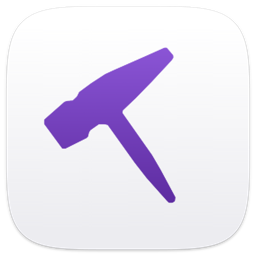
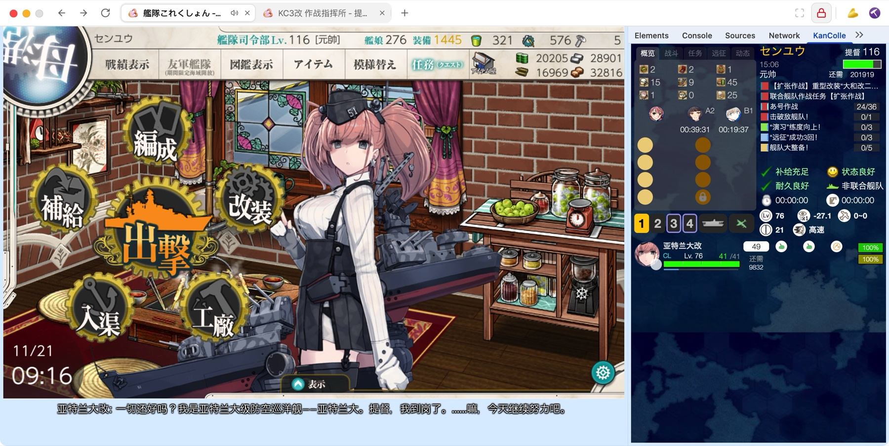

#  damecon-browser

[English](README.md) · [简体中文](README.zh-CN.md) · 繁體中文 · [日本語](README.ja.md)

專為遊玩《艦隊 Collection》設計的多分頁瀏覽器，內建 KC3Kai 與 KCCacheProxy，並支援 HTTP / SOCKS5 代理伺服器。



本專案衍生自 [planetarian/damecon-browser](https://github.com/planetarian/damecon-browser)，以 macOS 為主要開發與使用平台，基於 [electron-browser-shell](https://github.com/samuelmaddock/electron-browser-shell) 與 Electron 44 建置。每個版本皆提供 Apple Silicon 與 Intel Mac 安裝檔，以及 Windows 壓縮檔（x64、arm64）；其中 Windows 版本的測試相對有限。

> Damecon 專為遊玩《艦隊 Collection》而設計，並非通用瀏覽器，缺少主流瀏覽器的多項安全防護機制。請勿用來處理敏感資訊，若用於其他用途，相關風險需由使用者自行承擔。

## 安裝與使用

請前往 [Releases 頁面](https://github.com/yecl/damecon-browser/releases/latest)下載最新版本（KC3Kai 會在應用程式內自動更新，Damecon 本身的更新也會發布於此）：

- **macOS（13 Ventura 及以上版本）**：
  1. 下載並開啟對應架構的 `.dmg` 安裝檔（Apple Silicon 請選 `arm64`，Intel Mac 請選 `x64`）。
  2. 將 Damecon 拖入「應用程式」資料夾。
  3. 由於應用程式採用臨時簽署（ad-hoc）且未經 Apple 公證，首次開啟遭系統阻擋後，請前往**系統設定 → 隱私權與安全性**，點擊**強制打開**。
- **Windows**：
  1. 將 `.zip` 壓縮檔完整解壓縮至獨立的資料夾中。
  2. 執行其中的 `damecon-browser.exe`。

首次啟動時，Damecon 會自動下載 KC3Kai 並開啟其開始頁。點擊分頁列右側的 Damecon 圖示即可開啟**設定**。

### 可攜模式

在**設定 → Damecon → 資料**中將資料儲存位置設為**應用程式旁**後，所有資料都會儲存在程式同層的 `damecon-data` 資料夾內，並可供 macOS 版與 Windows 版共用：

```
Damecon/
  damecon-browser.app/
  damecon-browser-win32-x64-<version>/
  damecon-data/
```

所有設定、KC3Kai 資料、KCCP 快取與 mod 都會隨該資料夾一併遷移；不過 DMM 登入憑證依電腦分別加密保存，切換裝置或系統時需重新登入 DMM 帳號。在 macOS 上，若應用程式無法讀取同層資料夾，請先於終端機執行以下指令清除隔離屬性：

```bash
xattr -dr com.apple.quarantine damecon-browser.app
```

### 從原始碼建置

建置前請確認已安裝 Node.js 22.12 或更新版本：

```bash
git clone https://github.com/yecl/damecon-browser
cd damecon-browser
yarn
yarn start
```

## KC3Kai

可在**設定 → KC3Kai** 中選擇更新通道：

- `release`（建議，穩定版）、`master` 或 `develop`（開發版）。
- `custom`（自訂 1 / 自訂 2）：指向自行管理的本機 KC3 資料夾。

各通道的程式與資料相互獨立，切換通道不會重新下載。若要移除某個通道，直接刪除 `extensions` 資料夾下對應的 `kc3kai-*` 資料夾即可。

## 代理伺服器與 KCCacheProxy

**代理伺服器**頁上方會顯示各類網路流量的路由路徑：

- **代理伺服器**：開啟後，所有連線（網站瀏覽、登入、KC3 更新、Chrome 線上應用程式商店以及內建 KCCP 的下載）都會經由指定的 HTTP 或 SOCKS5 代理伺服器連線。不支援 ZeroOmega 等仰賴 `chrome.proxy` API 的擴充功能。
- **[KCCacheProxy](https://github.com/Tibowl/KCCacheProxy)（KCCP）**：可將遊戲資源快取至本機磁碟以加速載入，並支援套用資源 mod。KCCP 僅接管遊戲伺服器（`*.kancolle-server.com`）的流量，且位於代理伺服器之前；Damecon 僅針對這些網域信任 KCCP 憑證，不會寫入任何內容至系統鑰匙圈。
  - **內建**：由 Damecon 直接託管執行，快取、mod 與設定檔均儲存於 `userdata/kccp`。
  - **外部**：連接自行執行的 KCCP（填入其 HTTPS / MITM 連接埠），由外部 KCCP 透過自身的網路連線至遊戲伺服器。

在 **KCCP** 頁中可檢視執行狀態、統計資料與即時日誌，並使用**預先載入資源**、**匯入快取包**、**驗證快取**等工具。預設情況下，KCCP 僅會快取實際載入過的資源；開啟**一律向 KCCP 請求遊戲資源**或執行一次**清除瀏覽器快取**，即可逐步填充本機快取。

### 資源 mod

使用內建 KCCP 時，可在 KCCP 頁的 **Mod** 分頁中管理以下三種方式：

- **KCCP mod**：支援從 git 儲存庫安裝、新增 `.mod.json` 檔案或轉換 poi mod。由於僅替換圖片中的對應局部，遊戲版本更新後通常仍可正常運作。
- **`.hack` 檔案**：開啟**使用 .hack 檔案**後，依遊戲資源路徑將 `<name>.hack.<ext>` 放入 hack 資料夾（例如 `kcs2/resources/ship/full/<file>.hack.png`），以整檔替換原本的資源。
- **艦娘 `config.ini`（島風GO 格式）**：將 `<ship file>.config.ini` 放入 hack 資料夾內的 `kcs/resources/swf/ships/` 中，可在遊戲啟動時調整艦娘立繪位置與名稱。

新增或刪除 `.hack` 與 `config.ini` 檔案後，請點擊**重新載入**使其生效。

## 擴充功能

放在 `extensions` 資料夾中已解壓縮的擴充功能會自動載入（同時支援 Manifest V2 與 V3），亦可直接從 Chrome 線上應用程式商店安裝。由於部分擴充功能 API 尚未實作，並非所有擴充功能皆可執行，例如 `chrome.proxy`、`webRequest.onAuthRequired`，以及開發人員工具或 iframe 內擴充功能頁面所使用的 `tabs` / `windows` / `downloads` API。

## 遊戲與瀏覽體驗

- **適應視窗**：點擊分頁列中的此按鈕可將遊戲畫面縮放至填滿目前分頁（同時適用於 DMM 遊戲頁面與 KC3 遊戲頁面）；在**設定 → Damecon → 艦これ → 影格率**中最高可將遊戲設為 240 FPS 執行。
- **網址列**：點擊目前選取的分頁，或按 `Cmd/Ctrl+L` 即可輸入網址。
- **常用快速鍵**：使用 `Cmd+[` / `Cmd+]`（Windows 為 `Alt+←` / `Alt+→`）或滑鼠側鍵返回上一頁／前往下一頁；按 `Cmd/Ctrl+Shift+T` 重新開啟已關閉的分頁；按 `Cmd/Ctrl+F` 在頁面中尋找。
- **網站權限**：網站請求使用相機、位置或通知等權限前，會先跳出視窗徵詢你的允許。
- **介面語言**：支援英文、簡體中文、繁體中文與日文，預設跟隨系統語言，可於**設定 → Damecon → 視窗 → 語言**中隨時變更。

## 授權

GPL-3

本專案基於 Samuel Maddock 的 [electron-browser-shell](https://github.com/samuelmaddock/electron-browser-shell) 建置。

以下聲明保留自原儲存庫（以英文原文為準）：

> For proprietary use [of electron-browser-shell], please [contact [samuelmaddock]](mailto:sam@samuelmaddock.com?subject=electron-browser-shell%20license) or [sponsor [samuelmaddock] on GitHub](https://github.com/sponsors/samuelmaddock/) under the appropriate tier to [acquire a proprietary-use license](https://github.com/samuelmaddock/electron-browser-shell/blob/master/LICENSE-PATRON.md). These contributions help make development and maintenance of this project more sustainable and show appreciation for the work thus far.

### 貢獻者授權協議

貢獻者授權協議以[英文版](README.md#contributor-license-agreement)為準。
